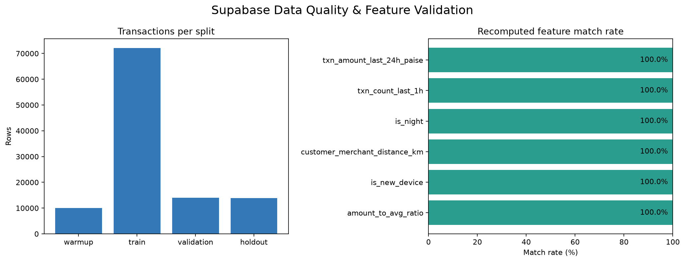

# Supabase data-quality and feature audit

Python project that reads the SENTINEL teaching dataset from Supabase into pandas,
checks data quality, recomputes selected transaction features without using future
events, compares them with the stored `features` table, and saves an output chart.

> **Dataset note:** SENTINEL is a synthetic classroom dataset. This project is for
> learning and validation, not production fraud decisions.

## What it checks

- Loads `customers`, `merchants`, `devices`, `transactions`,
  `payment_outcomes`, `labels`, and `features` as pandas DataFrames.
- Reports nulls by column, exact/key duplicates, database-column count, amount
  IQR outliers, amount/paise consistency, and transaction rows by split.
- Recomputes prior-90-day amount ratio and device novelty, Haversine distance,
  IST night status, prior-hour transaction count, and prior-24-hour amount.
- Compares computed features and R01–R08 rules with the stored reference values.
- Excludes current and same-timestamp events from history calculations.

The class data bundle defines R01–R06 and the additional R07 velocity and R08
high-risk category rules. The high-risk “MCC” rule uses the bundle's synthetic
merchant categories (`electronics`, `gaming`, `gift_cards`); the data has no
numeric MCC field. Amount outliers use the Tukey 1.5×IQR fence. Nulls in optional
or unknown fields are reported, not automatically treated as errors.

## Requirements

- Python 3.10+
- A Supabase project populated with the SENTINEL tables
- A PostgreSQL connection string with read access to those tables

## Setup (Windows PowerShell)

```powershell
git clone https://github.com/tsaraju/Dataplatformpipeline.git
cd Dataplatformpipeline
py -m venv .venv
.\.venv\Scripts\Activate.ps1
python -m pip install -r requirements.txt
Copy-Item .env.example .env
```

Edit `.env` and set `DATABASE_URL` to your Supabase PostgreSQL connection string.
Use **Project Settings → Database → Connect → Session pooler** to obtain it.
Keep the password private: `.env` is ignored by Git and must never be committed.
The project uses the PostgreSQL connection for read-only queries; it does not
need a Supabase publishable key or Storage bucket access.

## Run

```powershell
python .\analyze_supabase.py
```

The script prints the loaded pandas DataFrame names and row counts, split counts,
feature match rates, and mismatch total. It writes:

- `reports/data_quality.json`
- `reports/nulls_by_column.csv`
- `reports/feature_match_rates.csv`
- `reports/feature_mismatches.csv`
- `reports/reason_code_match_rates.csv`
- `screenshots/data_quality_report.png`

Generated reports are local outputs and are excluded from Git by default. To
choose different output directories:

```powershell
python .\analyze_supabase.py --output-dir .\reports --screenshot-dir .\screenshots
```

## Example output

Example from the supplied 110,000-row synthetic dataset:

```text
Loaded pandas DataFrames:
  customers_df: 2,500 rows x 6 columns
  merchants_df: 200 rows x 5 columns
  devices_df: 10,120 rows x 3 columns
  transactions_df: 110,000 rows x 18 columns
  payment_outcomes_df: 110,000 rows x 5 columns
  labels_df: 110,000 rows x 7 columns
  features_df: 110,000 rows x 22 columns

Transaction rows per split:
  warmup       10,000
  train        72,050
  validation   14,061
  holdout      13,889

Feature match rates:
  amount_to_avg_ratio                    110,000/110,000 100.00%
  is_new_device                          110,000/110,000 100.00%
  customer_merchant_distance_km          110,000/110,000 100.00%
  is_night                               110,000/110,000 100.00%
  txn_count_last_1h                      110,000/110,000 100.00%
  txn_amount_last_24h_paise              110,000/110,000 100.00%

Feature mismatches: 0
```

### Screenshot of the generated report



The chart is generated by the script from aggregate split counts and feature
match rates; it does not display transaction-level data or credentials.

## Publish this folder as a public GitHub repository

Create a **new empty public repository** on GitHub (do not initialize it with a
README), then run these commands from this folder:

```powershell
git init
git add .gitignore .env.example README.md requirements.txt analyze_supabase.py screenshots
git status
git commit -m "Add Supabase data quality audit"
git branch -M main
git remote add origin https://github.com/tsaraju/Dataplatformpipeline.git
git push -u origin main
```

Before pushing, inspect `git status` and confirm `.env`, `.venv`, and reports
are not staged. Do not place credentials in screenshots, README output, source
files, commit messages, or GitHub Actions settings visible to the public.
